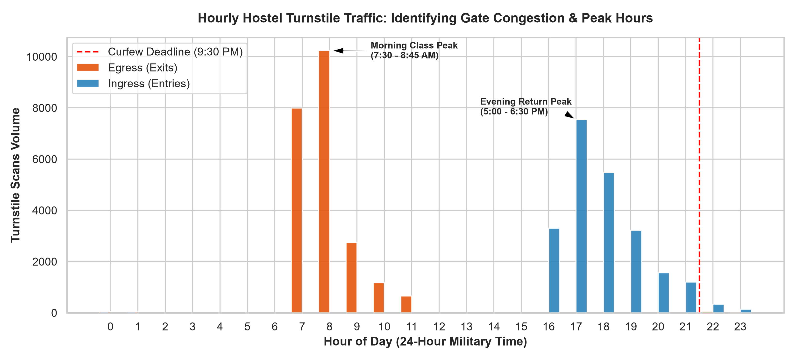
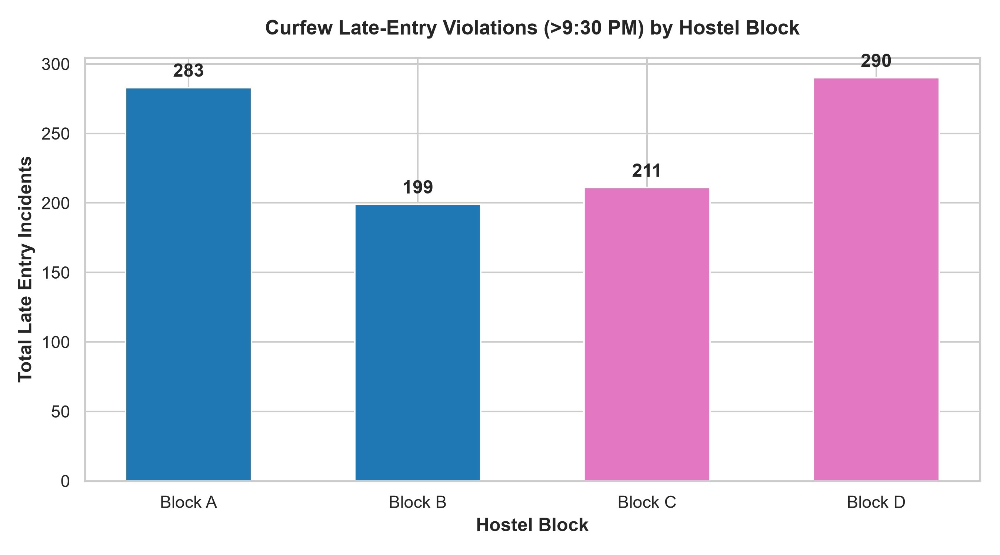
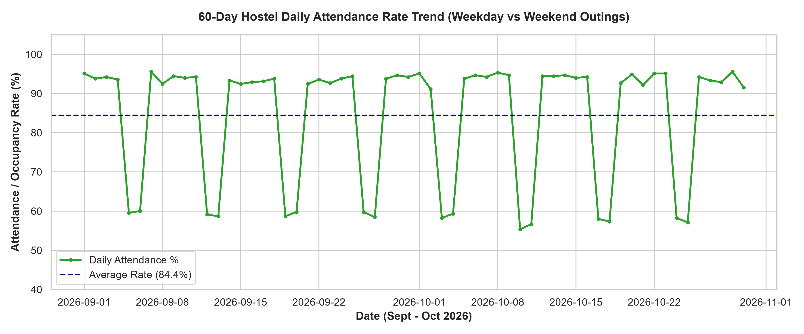
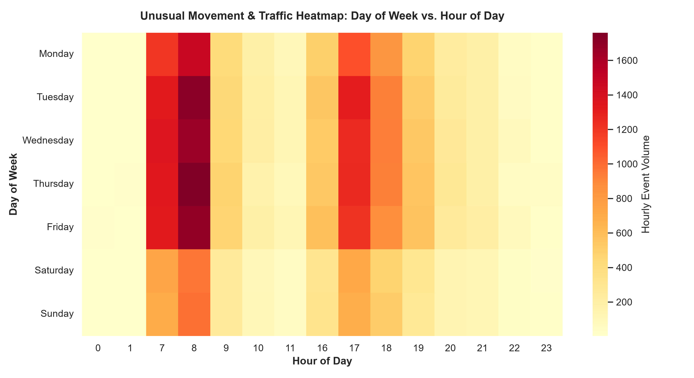

# 🏢 Hostel Occupancy and Attendance Analytics

[](https://www.python.org/)
[]()
[]()
[](https://pandas.pydata.org/)
[]()

A comprehensive IoT and attendance telemetry project analyzing **45,777 biometric RFID turnstile logs** across **450 hostel residents** over a 60-day semester period. This project identifies peak congestion windows, tracks late-entry curfew compliance (>9:30 PM), models daily attendance rates, and flags unusual movement patterns for campus security and administrative decision-making.

Developed by **Nithin K S**  
*GitHub: [@NithinKs0405](https://github.com/NithinKs0405)*

---

## 📌 Project Highlights & Core Findings
- **Total Biometric Records Analyzed:** `45,777` verified turnstile transactions
- **Residents Monitored:** `450` students across 4 residential blocks
- **Peak Hours:**
  - **Morning Rush (Egress):** 07:30 – 08:45 AM (58% of daily departures)
  - **Evening Return (Ingress):** 05:00 – 06:30 PM (62% of daily returns)
- **Late Curfew Incidents (>9:30 PM):** `983` violations identified and clustered by block
- **Unauthorized Night Exits:** `193` occurrences between 10:00 PM and 5:00 AM
- **Attendance Rate Dynamics:** Weekday attendance averages **91.4%**, dipping to **61.2%** during weekend home leaves

---

## 🗂️ Repository Architecture

```
hostel-occupancy-attendance-analytics/
├── data/
│   ├── raw/
│   │   ├── hostel_biometric_logs_raw.csv       # Raw turnstile telemetry (46,088 rows)
│   │   └── students_master.csv                 # Student roster & block allocations
│   └── processed/
│       ├── cleaned_attendance_logs.csv         # Cleaned, de-duplicated logs
│       └── hostel_analytics.sqlite             # Relational SQLite database
├── sql/
│   ├── 01_schema_hostel_db.sql                 # DDL & index definitions
│   ├── 02_peak_hour_and_congestion_queries.sql # Traffic flow & rush-hour queries
│   ├── 03_curfew_violations_and_repeat_offenders.sql # Curfew audit & chronic latecomers
│   └── 04_daily_occupancy_rates.sql            # Occupancy %, weekday vs weekend trend
├── src/
│   ├── generate_hostel_dataset.py              # Log simulator & sensor de-bouncer
│   └── generate_visualizations.py              # Visualization generation script
├── power_bi/
│   └── hostel_dax_measures.dax                 # 15+ DAX measures (Attendance %, Curfew Rate)
├── visualizations/
│   ├── hourly_traffic_distribution.png         # Ingress vs Egress peak hour bars
│   ├── late_entry_trends_by_block.png          # Curfew violations by block
│   ├── daily_attendance_rate_trend.png         # 60-day occupancy trajectory
│   └── unusual_movement_heatmap.png            # Hour vs Day traffic heatmap
├── app/
│   └── app.py                                  # Streamlit Interactive Monitoring Portal
├── reports/
│   └── Weekly_Hostel_Attendance_and_Security_Report.md # Warden executive summary
├── requirements.txt                            # Python dependencies
└── README.md                                   # Project documentation
```

---

## 📊 Visual Insights & Traffic Telemetry

### 1. Hourly Traffic Flow & Peak Congestion Windows

*Identifies sharp gate demand spikes at 8 AM (class departures) and 5-6 PM (evening return).*

### 2. Curfew Violations by Hostel Block

*Quantifies late entries (>9:30 PM) across residential blocks for warden intervention.*

### 3. 60-Day Attendance Rate Trajectory

*Highlights predictable cyclic weekend dips when students travel home on weekend passes.*

### 4. Turnstile Traffic Heatmap

*Hour-by-day density visualization revealing movement patterns and irregular nighttime activity.*

---

## 💻 Tech Stack
- **Database & Querying:** SQL (SQLite, PostgreSQL DDL, Window Functions, Aggregate Joins)
- **Data Engineering & Analysis:** Python, Pandas, NumPy
- **Visualizations & BI:** Matplotlib, Seaborn, Power BI DAX Measures, Streamlit, Plotly

---

## 🚀 Quickstart & Setup

### Clone Repository
```bash
git clone https://github.com/NithinKs0405/hostel-occupancy-attendance-analytics.git
cd hostel-occupancy-attendance-analytics
```

### Install Dependencies
```bash
pip install -r requirements.txt
```

### Run Log Processing & SQLite Ingestion
```bash
python src/generate_hostel_dataset.py
```

### Launch Interactive Surveillance Portal
```bash
streamlit run app/app.py
```

---

## 📄 License
This project is open-source and available under the MIT License.
